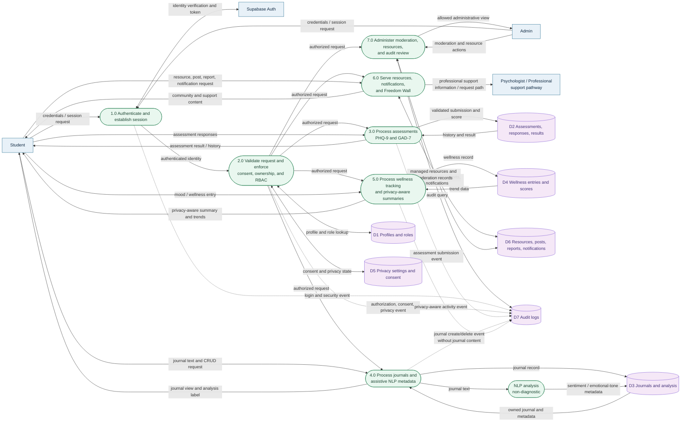

# MindTrack Campus Data Flow Diagram (DFD)

**Project:** MindTrack Campus - A Web-Based Mental Wellness Monitoring and Student Support System

This is a logical Level 1 DFD. External entities are rectangles, processes are rounded nodes, and data stores are database cylinders.

## Privacy and Security Rules

- A request reaches feature processing only after authentication, consent checks where applicable, role checks, and ownership checks.
- `anonymize_activity = true` affects aggregate activity outputs by removing names, direct identifiers, and identifying dates as defined by the approved privacy policy.
- Anonymous Freedom Wall posting means anonymous to other students; it does not automatically mean anonymous to the backend or system administrators.
- Audit data describes the event and actor; it must not contain journal contents, passwords, or access tokens.
- The professional support pathway is student-facing. It is not a counselor or psychologist management dashboard.
