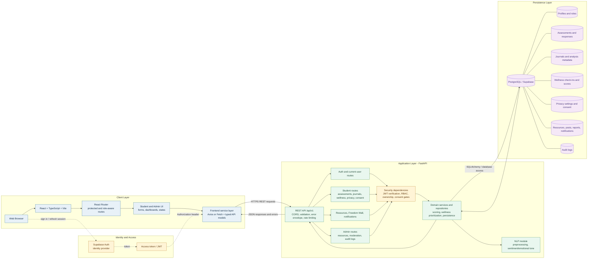

# MindTrack Campus System Architecture Diagram

**Project:** MindTrack Campus - A Web-Based Mental Wellness Monitoring and Student Support System

**Scope:** React/Vite frontend, FastAPI REST backend, Supabase Auth/JWT validation, PostgreSQL/Supabase persistence, privacy enforcement, RBAC, audit logging, and assistive NLP.

> Frontend route guards improve usability, but backend authorization and privacy enforcement are the actual security boundary.

## Architecture Notes

- The frontend communicates with versioned FastAPI endpoints through a service layer; it does not connect directly to PostgreSQL/Supabase.
- FastAPI validates the identity token, resolves the profile and role, and applies authorization dependencies.
- Student-owned data, especially journals and assessments, is filtered by authenticated ownership. Admin access is explicit per endpoint and is not unrestricted access to private journals.
- PHQ-9 and GAD-7 scoring is performed by the backend using approved instrument data. The frontend collects responses and renders the returned result.
- Journal NLP is assistive metadata only and must not be represented as a diagnosis or clinical decision.
- Audit logs capture security and administrative events without storing passwords, tokens, or journal contents.
