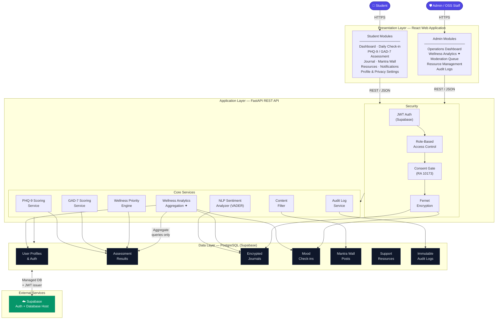
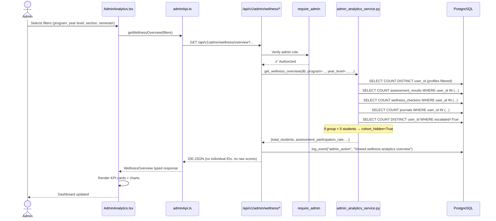
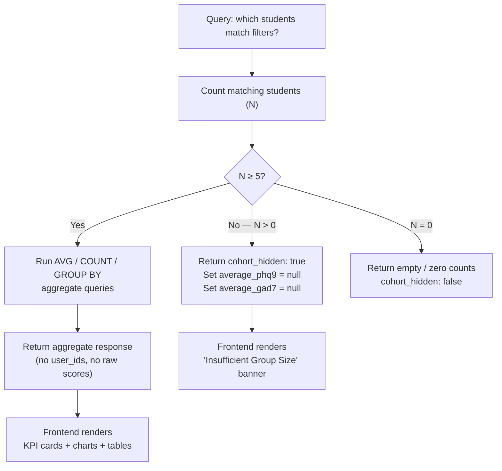
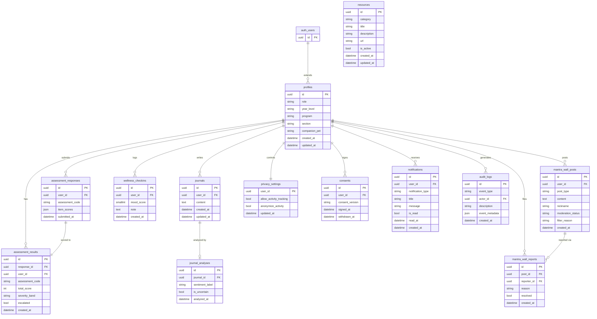
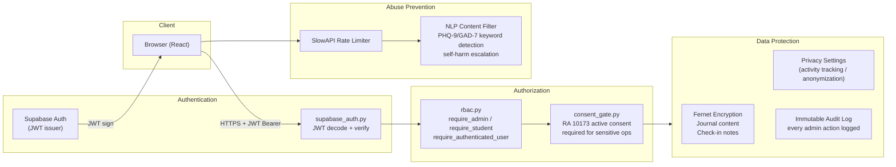

# MindTrack Campus — Proposed System Architecture

**Polytechnic University of the Philippines – Santa Maria Campus**

### Architecture Summary

| Layer | Technology | Role |
|---|---|---|
| **Presentation** | React + TypeScript (Vite) | Student & admin web interfaces; role-guarded routing |
| **Application** | FastAPI (Python) | REST API; authentication, authorization, scoring, analytics |
| **Data** | PostgreSQL via Supabase | Persistent storage; journals encrypted at application layer |
| **Auth** | Supabase Auth (JWT) | Identity management; session tokens; role assignment |
| **NLP** | VADER Sentiment Analyzer | Journal sentiment analysis; mantra wall content filtering |
| **Clinical Instruments** | PHQ-9 (Kroenke et al., 2001) · GAD-7 (Spitzer et al., 2006) | Evidence-based depression and anxiety screening |
| **Privacy** | Fernet encryption · RA 10173 consent gate | End-to-end data protection; active consent required |
| **Analytics** ✦ | Aggregate-only queries · MIN cohort size = 5 | Wellness metrics for admin/OSS — no individual data exposed |

> **Institution:** Polytechnic University of the Philippines, Santa Maria Campus  
> **Stack:** React + TypeScript · FastAPI · PostgreSQL (Supabase) · VADER NLP  
> **Last updated:** Phase 23 + Wellness Analytics (Phase 24 prep)

---

## Top-Level Component Map

```mermaid
graph TB
    %% ── External Actors ───────────────────────────────────────────────────
    STUDENT["👤 Student\n(PUP Santa Maria)"]
    ADMIN["🛡️ Admin / OSS Staff"]

    %% ── Frontend (React/Vite) ─────────────────────────────────────────────
    subgraph FE["Frontend — React + TypeScript (Vite, port 5173)"]
        direction TB

        subgraph FE_AUTH["Auth & Session"]
            AuthCtx["AuthContext\n(Supabase JWT)"]
            ProtectedRoute["ProtectedRoute\n(role-based guard)"]
        end

        subgraph FE_STUDENT["Student Pages"]
            PgDash["StudentDashboard"]
            PgAssess["Assessments\n(PHQ-9 / GAD-7)"]
            PgJournal["Journal\n(encrypted entries)"]
            PgCheckin["DailyCheckIn\n(mood 1–5)"]
            PgMantra["MantraWall\n(affirmations)"]
            PgResources["Resources"]
            PgProfile["Profile"]
            PgPrivacy["PrivacySettings"]
            PgNotif["Notifications"]
            PgSupport["ProfessionalSupport"]
        end

        subgraph FE_ADMIN["Admin Pages"]
            PgAdminDash["AdminDashboard\n(ops KPIs, charts)"]
            PgAnalytics["AdminAnalytics ✨\n(Wellness Analytics)"]
            PgMod["AdminModeration\n(Mantra Wall queue)"]
            PgRes["AdminResourceManagement"]
            PgAudit["AuditLogs\n(read-only)"]
            PgSystem["SystemInfo"]
        end

        subgraph FE_SVC["Frontend Services"]
            AdminApi["adminApi.ts\n(operational + wellness endpoints)"]
            StudentApi["studentApi.ts"]
            AdminCache["adminCache.ts\n(in-memory TTL cache)"]
        end

        Layout["Layout.tsx\n(sidebar nav, theme, auth)"]
        Types["types/index.ts\n(mirrored Pydantic schemas)"]
    end

    %% ── Backend (FastAPI) ─────────────────────────────────────────────────
    subgraph BE["Backend — FastAPI (Uvicorn, port 8000)"]
        direction TB

        subgraph BE_MW["Middleware"]
            CORS["CORS\n(localhost + Cloudflare)"]
            RateLimit["SlowAPI\nRate Limiter"]
            ErrHandler["Error Envelope\nHandlers"]
        end

        subgraph BE_ROUTES["API Routes  /api/v1/"]
            R_Auth["auth.py\n/auth/me"]
            R_Assess["assessments.py\n/assessments/phq9 /gad7"]
            R_GAD7["gad7.py\n/gad7"]
            R_Journal["journals.py\n/journals"]
            R_Wellness["wellness.py\n/wellness/priority"]
            R_Checkin["wellness_checkins.py\n/wellness/checkins"]
            R_Privacy["privacy.py\n/privacy"]
            R_Consent["consent.py\n/consent"]
            R_Mantra["mantra_wall.py\n/mantra-wall"]
            R_Resources["resources.py\n/resources"]
            R_Notif["notifications.py\n/notifications"]
            R_AuditLogs["audit_logs.py\n/admin/audit-logs"]
            R_AnalyticsOps["admin_analytics.py\n/admin/analytics/*\n(operational KPIs)"]
            R_AnalyticsWellness["admin_analytics.py\n/admin/wellness/* ✨\n(wellness analytics)"]
            R_Profile["profile.py\n/profile"]
        end

        subgraph BE_SEC["Security Layer"]
            SupabaseAuth["supabase_auth.py\nJWT verification"]
            RBAC["rbac.py\nrequire_admin / require_student"]
            ConsentGate["consent_gate.py\nRA 10173 consent check"]
            Encryption["encryption.py\nFernet (journal + checkin notes)"]
        end

        subgraph BE_SVC["Services / Business Logic"]
            PHQ9Svc["phq9_service.py\nscoring + severity bands"]
            GAD7Svc["gad7_service.py\nscoring + severity bands"]
            WellnessPrio["wellness_prioritization.py\nrule-based priority signal"]
            QualFeedback["qualitative_feedback.py\nnon-numeric labels"]
            ContentFilter["content_filter.py\nNLP pre-moderation"]
            NLP["nlp/service.py\nVADER sentiment analyzer"]

            AssessRepo["assessment_repository.py"]
            JournalRepo["journal_repository.py"]
            CheckinRepo["wellness_checkin_repository.py"]
            MantraRepo["mantra_wall_repository.py"]
            ResourceRepo["resource_repository.py"]
            ConsentRepo["consent_repository.py"]
            PrivacyRepo["privacy_repository.py"]
            AuditRepo["audit_log_repository.py\nlog_event()"]
            WellnessRepo["wellness_repository.py"]
            NotifRepo["notification_repository.py"]
            ProfileSvc["profile_service.py"]

            AnalyticsSvc["admin_analytics_service.py ✨\nget_wellness_overview()\nget_wellness_screening()\nget_wellness_by_group()\nget_wellness_trend()\nget_filter_options()\n+ get_overview_kpis()\n+ get_audit_timeline()\n+ get_moderation_timeline()"]
        end

        subgraph BE_DB["Database Layer"]
            Session["db/session.py\nSQLAlchemy engine"]
            Alembic["Alembic migrations"]
        end

        subgraph BE_MODELS["ORM Models"]
            M_Profile["Profile"]
            M_Assess["AssessmentResponse\nAssessmentResult"]
            M_Journal["Journal\nJournalAnalysis"]
            M_Checkin["WellnessCheckIn"]
            M_Mantra["MantraWallPost\nMantraWallReport"]
            M_Resource["Resource"]
            M_Consent["Consent"]
            M_Privacy["PrivacySettings"]
            M_Notif["Notification"]
            M_Audit["AuditLog"]
        end
    end

    %% ── External Infrastructure ───────────────────────────────────────────
    subgraph INFRA["External Infrastructure"]
        Supabase["☁️ Supabase\nauth.users + JWT issuer"]
        Postgres["🐘 PostgreSQL\n(Supabase DB, public schema)"]
    end

    %% ── Connections: Users → Frontend ─────────────────────────────────────
    STUDENT -->|"HTTPS / browser"| FE
    ADMIN -->|"HTTPS / browser"| FE

    %% ── Frontend internal ─────────────────────────────────────────────────
    FE_STUDENT --> AdminApi
    FE_STUDENT --> StudentApi
    FE_ADMIN --> AdminApi
    AdminApi --> AdminCache
    AdminApi --> Types
    StudentApi --> Types
    Layout --> FE_STUDENT
    Layout --> FE_ADMIN
    AuthCtx --> ProtectedRoute

    %% ── Frontend → Backend ────────────────────────────────────────────────
    AdminApi -->|"REST / JSON (Axios)"| BE_ROUTES
    StudentApi -->|"REST / JSON (Axios)"| BE_ROUTES

    %% ── Backend: Middleware chain ─────────────────────────────────────────
    BE_ROUTES --> CORS
    BE_ROUTES --> RateLimit
    BE_ROUTES --> ErrHandler

    %% ── Routes → Security ─────────────────────────────────────────────────
    R_Auth --> SupabaseAuth
    R_Assess --> SupabaseAuth
    R_Journal --> SupabaseAuth
    R_Checkin --> SupabaseAuth
    R_AuditLogs --> RBAC
    R_AnalyticsOps --> RBAC
    R_AnalyticsWellness --> RBAC
    R_Mantra --> ConsentGate
    R_Journal --> ConsentGate

    %% ── Routes → Services ─────────────────────────────────────────────────
    R_Assess --> PHQ9Svc
    R_GAD7 --> GAD7Svc
    R_Assess --> AssessRepo
    R_Journal --> JournalRepo
    R_Journal --> NLP
    R_Checkin --> CheckinRepo
    R_Wellness --> WellnessPrio
    R_Wellness --> AssessRepo
    R_Mantra --> ContentFilter
    R_Mantra --> MantraRepo
    R_Resources --> ResourceRepo
    R_Consent --> ConsentRepo
    R_Privacy --> PrivacyRepo
    R_Notif --> NotifRepo
    R_Profile --> ProfileSvc
    R_AuditLogs --> AuditRepo
    R_AnalyticsOps --> AnalyticsSvc
    R_AnalyticsWellness --> AnalyticsSvc

    %% ── Service cross-dependencies ────────────────────────────────────────
    PHQ9Svc --> QualFeedback
    GAD7Svc --> QualFeedback
    WellnessPrio --> PHQ9Svc
    WellnessPrio --> GAD7Svc
    ContentFilter --> NLP
    JournalRepo --> Encryption
    CheckinRepo --> Encryption

    %% ── Services → DB ─────────────────────────────────────────────────────
    AnalyticsSvc --> Session
    AssessRepo --> Session
    JournalRepo --> Session
    CheckinRepo --> Session
    MantraRepo --> Session
    ResourceRepo --> Session
    ConsentRepo --> Session
    PrivacyRepo --> Session
    AuditRepo --> Session
    NotifRepo --> Session
    WellnessRepo --> Session
    ProfileSvc --> Session

    %% ── ORM Models ────────────────────────────────────────────────────────
    Session --> BE_MODELS
    Alembic --> Postgres

    %% ── Backend → External ────────────────────────────────────────────────
    Session --> Postgres
    SupabaseAuth -->|"JWT validation"| Supabase
    Postgres -.->|"auth.users FK"| Supabase
```

---

## Admin Analytics Data Flow (Wellness Analytics)

---

## Privacy Threshold Enforcement

---

## Database Schema Overview

---

## Security Model

---

## Module Responsibilities (Quick Reference)

| Layer | Module | Key Responsibility |
|---|---|---|
| **Frontend** | `AuthContext` | Supabase session, role detection |
| | `ProtectedRoute` | Role-based route guard |
| | `adminApi.ts` | Typed HTTP calls to all admin + wellness endpoints |
| | `adminCache.ts` | In-memory result cache (avoids redundant fetches) |
| | `AdminAnalytics.tsx` ✨ | Wellness Analytics page — filters, KPIs, charts, tables |
| **Backend Routes** | `admin_analytics.py` | Operational KPIs + new wellness analytics router |
| | `assessments.py` / `gad7.py` | PHQ-9 / GAD-7 submission, history |
| | `journals.py` | Encrypted journal CRUD + NLP trigger |
| | `mantra_wall.py` | Community wall CRUD + admin moderation |
| **Security** | `supabase_auth.py` | JWT verification against Supabase |
| | `rbac.py` | Role guard dependencies |
| | `consent_gate.py` | RA 10173 active-consent enforcement |
| | `encryption.py` | Fernet encrypt/decrypt (journal + note content) |
| **Services** | `phq9_service.py` | Validated PHQ-9 scoring (Kroenke et al. 2001) |
| | `gad7_service.py` | Validated GAD-7 scoring (Spitzer et al. 2006) |
| | `wellness_prioritization.py` | Rule-based priority signal (DRAFT — pending validation) |
| | `qualitative_feedback.py` | Non-numeric severity labels (no score disclosure) |
| | `content_filter.py` | NLP-based pre-moderation tier |
| | `admin_analytics_service.py` ✨ | All wellness aggregation; privacy threshold enforced |
| | `audit_log_repository.py` | Immutable `log_event()` — never editable |
| **NLP** | `nlp/service.py` | VADER sentiment analysis (journal + content filter) |
| **DB** | `db/session.py` | SQLAlchemy engine + `get_db` dependency |
| | Alembic migrations | Schema versioning |
| **Infra** | Supabase | Auth (JWT) + PostgreSQL database host |
